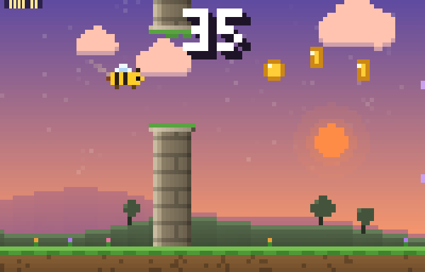

# 🐝 Bumble Rush

a simple game to kill time

Guide a little bee between stone and crystal pillars, grab honey, and see how far you can buzz before the sun sets... and rises again. Rendered with colored half-block pixels right in your terminal.



## Install

**Homebrew (macOS / Linux)**

```sh
brew install gg6789t/tap/bumble-rush
```

**Arch Linux (AUR)**

```sh
paru -S bumble-rush
```

**From source** (needs Rust)

```sh
cargo install --git https://github.com/gg6789t/bumble-rush
```

Then run `bumble-rush`.

## Controls

| Key | Action |
| --- | --- |
| `Space` / `W` / `↑` / mouse click | Flap |
| `P` | Pause |
| `Q` / `Esc` | Quit |

## Features

- **Honey drops** — +1 each, sometimes in arcs between pillars
- **Power-ups** — `S` shield (survives one crash), `T` slow-mo, `M` honey magnet, `2` double points
- **Close calls** — skim a pillar's edge for a bonus point
- **Moving crystal pillars** and a difficulty curve that keeps ramping up
- **Day → sunset → night → dawn** sky cycle with parallax scenery
- **Medals** — bronze 10, silver 25, gold 50, diamond 100
- Best score saved to `~/.bumble_rush_best`

## Colors

24-bit color is used when the terminal advertises it (iTerm2, Ghostty, WezTerm, Kitty, VS Code, …), otherwise it falls back to 256 colors. Force either with `--truecolor` or `--256`. Minimum terminal size is 40×16.

## License

MIT
